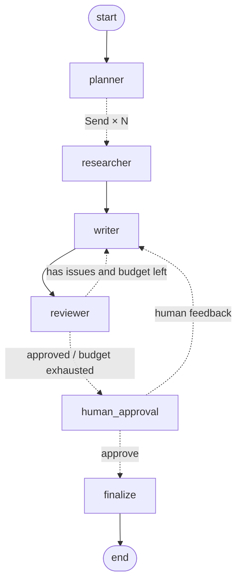

# research-team — a multi-agent research team on LangChain v1 + LangGraph

The user gives a topic → a team of agents plans the research, searches the web for facts
**in parallel**, writes a report with citations, reviews and rewrites it on its own, and
pauses for human approval before publishing.

The project demonstrates **both** patterns currently recommended by the LangChain docs:

| Pattern | Where in the code | When to use |
|---|---|---|
| **Custom StateGraph** — a deterministic workflow with agent nodes | `graph.py` | You need fixed steps, budgets, parallelism, checks, human-in-the-loop |
| **Supervisor + subagents-as-tools** — a main agent calls specialists as tools | `supervisor.py` | Conversation with the user, flexible "as the situation demands" routing |

> The `langgraph-supervisor` package is no longer maintained — the official replacement is
> exactly the subagents pattern on `create_agent`
> ([migration guide](https://docs.langchain.com/oss/python/migrate/langgraph-supervisor)).

## Workflow architecture



| Node | What it does | Technically |
|---|---|---|
| `planner` | Splits the topic into ≤ N independent sub-questions | `with_structured_output(ResearchPlan)`; the N limit is enforced **in code** |
| `researcher` ×N | Searches and reads sources for one sub-question | `create_agent` + `web_search`/`fetch_page`, `response_format=Finding`, middleware limits |
| `writer` | Writes a Markdown report **only** from findings, with `[n]` citations | Source numbering is deterministic, the LLM does not invent it |
| `reviewer` | Evaluates the draft | LLM verdict `Review` **+** rule-based citation check; the rules win |
| `human_approval` | Pauses until a human decides | `interrupt()` + `Command(resume=...)`, state in the checkpointer |
| `finalize` | Assembles the report and the source list | Plain code |

## Key engineering decisions (what you'll get asked about in an interview)

1. **Map-reduce via `Send`.** `planner` returns a list of `Send("researcher", {...})` —
   LangGraph runs the branches in parallel within one superstep, and `writer` starts only
   after all of them finish. Results are merged by the `Annotated[list[Finding], operator.add]`
   reducer, so parallel branches don't overwrite each other.
   ([Graph API: Send](https://docs.langchain.com/oss/python/langgraph/graph-api#send))
2. **Typed handoffs.** Agents exchange Pydantic objects (`SubQuestion`,
   `Finding`, `Review`) rather than free text — this makes the system testable and
   debuggable. ([Structured output](https://docs.langchain.com/oss/python/langchain/structured-output))
3. **Choosing the structured output method from the model profile** (`llm.structured`). Some
   models lack forced tool calling, so models with native structured output use
   `json_schema`. `create_agent` receives the schema type itself — LangChain picks
   `ProviderStrategy` or `ToolStrategy` on its own.
4. **Cost guardrails.** `ToolCallLimitMiddleware` and `ModelCallLimitMiddleware`
   bound the researcher loop; `max_revisions` bounds the writer↔reviewer loop.
   ([Built-in middleware](https://docs.langchain.com/oss/python/langchain/middleware/built-in))
5. **Graceful degradation.** A failed researcher returns a `Finding` with
   `confidence=0`, and the report is still assembled. Transient provider errors on
   planner/writer/reviewer are retried by a graph-level `RetryPolicy`.
6. **Human-in-the-loop.** `interrupt()` saves state to the checkpointer and hands the
   draft out; resuming is `graph.invoke(Command(resume="approve"), config)`.
   Code before `interrupt()` re-runs on resume, so it has no side effects.
   ([Interrupts](https://docs.langchain.com/oss/python/langgraph/interrupts))
7. **Safe checkpoint deserialization.** Recent LangGraph warns about (and will
   block in the future) unregistered types in checkpoints — so
   `make_checkpointer()` explicitly registers state types in `allowed_msgpack_modules`.
8. **Tool safety.** The URL for `fetch_page` is chosen by the model — so it is
   untrusted input: there is an SSRF guard (blocks localhost/private networks/metadata IPs,
   re-checks after redirects). The calculator uses an AST whitelist instead of `eval()`.
9. **Dependency injection for tests.** The graph depends only on `TeamDeps`
   (four callables), so every scenario — parallelism, the review loop, the budget,
   interruption and human feedback — is tested without network or keys.
10. **Context isolation in the supervisor pattern.** Subagents are stateless and receive only
    the task text; conversation memory belongs to the supervisor; only the outer agent has a checkpointer.
    ([Subagents](https://docs.langchain.com/oss/python/langchain/multi-agent/subagents))

## Structure

```
src/research_team/
  config.py      # pydantic-settings, all parameters via env (RT_*)
  llm.py         # init_chat_model + structured output method selection
  schemas.py     # SubQuestion, ResearchPlan, Finding, Source, Review
  prompts.py     # system prompts in one place
  tools/         # web_search (Tavily | DuckDuckGo), fetch_page (SSRF guard), calculator
  agents.py      # planner / researcher (create_agent) / writer / reviewer + TeamDeps
  reporting.py   # deterministic part: source catalog, citation checks, assembly
  graph.py       # StateGraph: Send, reducer, RetryPolicy, interrupt, checkpointer
  supervisor.py  # pattern #2: supervisor + subagents as tools
  cli.py         # run / chat / graph
tests/           # 28 offline tests
```

## Running

```bash
python -m venv .venv && source .venv/bin/activate
pip install -e ".[dev]"            # + ".[openai]" or ".[tavily]" if you want
cp .env.example .env               # add ANTHROPIC_API_KEY (or another provider)

research-team run "Comparing vector databases for RAG in 2026"   # with approval
research-team run "State of WebAssembly on the server" --no-approval
research-team chat                 # conversation with the supervisor
research-team graph                # Mermaid diagram of the graph
pytest -q                          # tests without network or keys
```

The report is saved to `reports/<slug>.md`. Switching providers is one variable:
`RT_MAIN_MODEL=openai:gpt-5.5` (the `provider:model` format from
[`init_chat_model`](https://docs.langchain.com/oss/python/langchain/models)).

**LangGraph Studio:** `pip install "langgraph-cli[inmem]" && langgraph dev` — the
`research_team` graph from `langgraph.json` opens in the visual debugger (the server
provides its own checkpointer). **LangSmith:** uncomment `LANGSMITH_*` in `.env` to
see traces of every agent and tool call.

## Where to take it next

- `PostgresSaver` / `SqliteSaver` instead of in-memory — resume work after a restart.
- FastAPI endpoints `POST /runs`, `POST /runs/{id}/resume` on top of the same graph.
- Report quality evaluation (LLM-as-judge over a set of topics) in CI.
- Caching search results (`CachePolicy` on the researcher node).

## Primary sources

- LangChain multi-agent overview: https://docs.langchain.com/oss/python/langchain/multi-agent
- Subagents pattern: https://docs.langchain.com/oss/python/langchain/multi-agent/subagents
- Router pattern (Send fan-out): https://docs.langchain.com/oss/python/langchain/multi-agent/router
- Migration from langgraph-supervisor: https://docs.langchain.com/oss/python/migrate/langgraph-supervisor
- Structured output: https://docs.langchain.com/oss/python/langchain/structured-output
- LangGraph interrupts: https://docs.langchain.com/oss/python/langgraph/interrupts
- LangGraph Graph API (StateGraph, Send, Command): https://docs.langchain.com/oss/python/langgraph/graph-api
